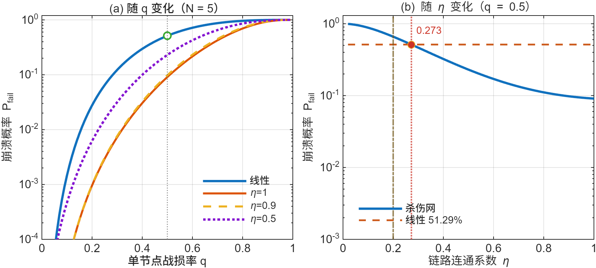
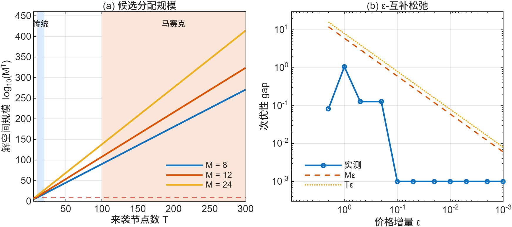

# killweb-sim

动态杀伤网的拓扑耐久性、诱饵稀释与武器-目标分配（WTA）的 MATLAB 实现。

本仓库是论文《“马赛克战”与动态杀伤网》第 2 章的数值复算程序，包含两组模型：
线性杀伤链与网状杀伤网的连通率/崩溃概率，以及诱饵稀释后的兰彻斯特方程与 WTA 的
0-1 整数规划、拍卖算法求解。所有数字都能在本地重算，不依赖外部数据。

## 运行

需要 MATLAB R2025b，只用到基础 MATLAB 与 Optimization Toolbox 的 `linprog`。

```matlab
cd killweb-sim
run_all
```

或从命令行：

```
matlab -batch run_all
```

一次运行约 22 s，在 `out/` 下生成 13 张图（300 dpi PNG 与矢量 PDF 各一份）、
2 张 LaTeX 三线表、1 份 Markdown 报告，以及全部中间结果的 `.mat`。

## 目录

```
run_all.m              入口：算例 -> 图件 -> 一致性校核 -> 报告
cfg/paper_params.m     全部参数（唯一出处）
sec22/                 拓扑与连通概率
sec23/                 兰彻斯特、WTA、拍卖
test/                  24 项数值回归断言
utils/                 绘图、导出、报告
docs/                  README 用的两张图
```

## 模型

| 文件 | 内容 |
|---|---|
| `sec22/pfail_linear.m` | 线性杀伤链崩溃概率 $(1-(1-q)^3)^N$ |
| `sec22/pfail_web_baseline.m` | 网状结构在 $\eta=1$ 时的基准 $1-(1-q^N)^3$ |
| `sec22/pfail_web_exact.m` | 含链路失效的三重求和精确枚举 |
| `sec22/pfail_web_mc.m` | 逐节点伯努利蒙特卡洛 |
| `sec22/expected_paths.m` | 期望可用路径数与 $\eta=1/N$ 拐点 |
| `sec23/lanchester_solve.m` | 兰彻斯特平方律，事件检测终止 |
| `sec23/alpha_effective.m` | 诱饵稀释后的有效杀伤率 |
| `sec23/wta_obj.m`、`wta_enum.m`、`wta_bnb.m` | WTA 连乘目标、穷举、分支定界 |
| `sec23/auction_assign.m` | Bertsekas 拍卖（$\varepsilon$-scaling 与 $\varepsilon$-CS 校验） |
| `sec23/cost_exchange.m` | 单次交战口径的成本比 |

## 结果



$N=5$、$q=0.5$ 时，网状结构在 $\eta=0.9$ 下的崩溃概率为 9.79\%，线性结构为 51.29\%；
$\eta=1$ 时分别为 9.09\% 与 51.29\%。$\eta$ 的两个判据交叉点分别是 0.200（期望路径）
与 0.273（崩溃概率）。



$M=24$、$T=300$ 的候选分配数为 $10^{414}$；$M=24$、$T=40$ 时拍卖算法 282 轮收敛，
$\varepsilon$-CS 违反量 0.01。加性代理与精确连乘目标的差异见 `out/report.md`。

## 参数与边界

- 参数取自公开文献的量级估计，`cfg/paper_params.m` 中逐项注明口径；不含任何非公开数据。
- $\alpha_B$、$\alpha_R$ 只用于展示稀释前后的相对变化，绝对值不影响结论。
- 模型假设节点独立受损、链路独立失效，未计入空间相关性与弹药基数，结果是连通能力的上界。

## 复现

随机种子固定（蒙特卡洛 20261102、WTA 算例 7），重复运行结果逐位一致。
`test/test_paper_numbers.m` 把 24 个结论数字写成断言，改参数后能直接看出哪一项漂移，
失败即报错退出。

## 许可

MIT，见 `LICENSE`。

## 声明

仅供建模仿真与教学研究使用。模型、参数与结论不构成对任何实际作战方案或装备性能的判断。
